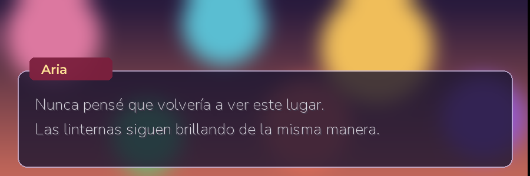
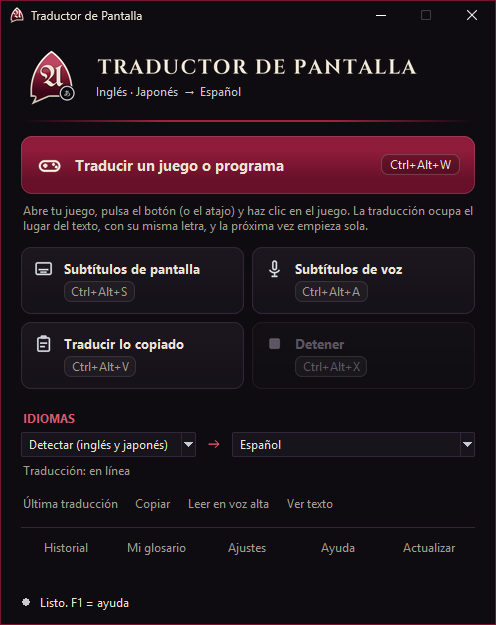

  <a href="https://github.com/Luxemanuel/TraductorPantalla/releases/latest"><b>⬇&nbsp; Descargar para Windows</b></a>

Traduce juegos y programas **en vivo**: el texto en inglés o japonés se reemplaza por tu idioma
**en el mismo sitio y con la misma letra**, como si el juego viniera traducido. Pensado para
novelas visuales, RPG, menús y cinemáticas.

<table>
  <tr>
    <td></td>
    <td></td>
  </tr>
  <tr>
    <td align="center">Original</td>
    <td align="center">Traducido en vivo (misma letra, misma sombra, mismo sitio)</td>
  </tr>
</table>

## Cómo se usa

1. Descarga `TraductorPantalla-Windows.zip`, descomprímelo y abre **Traductor de Pantalla.exe**.
2. Abre tu juego y pulsa **Ctrl+Alt+W** (o el botón principal y luego un clic en el juego).
3. Listo: la traducción ocupa el lugar del texto. La próxima vez que abras ese juego, empieza sola.

Mantén **F8** para ver el original. **Ctrl+Alt+X** lo detiene todo. **Ctrl+Alt+Espacio** abre un
menú con todas las acciones junto al cursor.

## Qué hace

- **Estilo natural**: imita la letra, el color, el contorno y la sombra del texto original, y usa
  las fuentes del propio juego cuando las encuentra (también dentro de los archivos de Ren'Py).
- **Sigue el ritmo**: el texto que se escribe solo o cambia rápido se traduce al terminar; lo que
  vuelve a aparecer recupera su traducción al instante.
- **Japonés de verdad**: lee japonés e inglés a la vez; la furigana no se traduce aparte.
- **Subtítulos**: de una franja de la pantalla o de **voz** (lo que suena en tus altavoces).
- **Memoria y correcciones**: lo traducido se recuerda; si corriges una frase, se usa siempre tu versión.
- **Perfiles por juego**: zona y letra de cada juego, con inicio automático.
- **Atajos fiables**: funcionan aunque el juego se abra como administrador.
- **Actualizaciones verificadas**: el programa se actualiza solo y comprueba cada descarga (SHA-256).

## Requisitos

- Windows 10 (versión 2004 o posterior) u 11.
- Para japonés: el lector japonés de Windows (gratis). Si falta, el programa ofrece instalarlo en
  *Ajustes → Traducción*.
- El juego en **ventana** o **ventana sin bordes**. En pantalla completa *exclusiva* Windows no deja
  dibujar encima; el programa lo detecta y te avisa.

## Si Windows avisa al abrirlo

El programa aún no lleva firma digital, así que la primera vez Windows puede mostrar «Windows
protegió su PC»: *Más información → Ejecutar de todas formas*. Para evitarlo, antes de descomprimir:
clic derecho en el `.zip` → *Propiedades* → marca **Desbloquear**. Después, el programa se
actualiza solo y Windows no vuelve a avisar.

## Privacidad

La traducción en línea envía el texto leído a Google Translate. Sin internet se usan diccionarios
guardados en tu PC. Además, el programa consulta GitHub para buscar actualizaciones y descarga los
diccionarios o el modelo de voz la primera vez que los necesitas. Tu historial, tu memoria de
traducciones y tus perfiles se guardan solo en la carpeta del programa.

Las fuentes incluidas tienen licencia SIL Open Font License (ver <code>fuentes/LICENCIAS_OFL.txt</code>).
